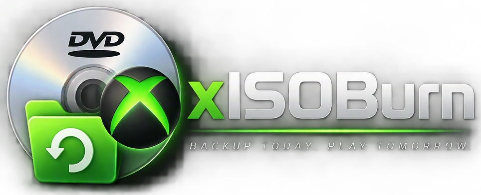

<p align="center">
  
</p>

# xISOBurn for Windows

The Windows version of [xISOBurn](https://github.com/rubinhos/xisoburn). It copies the disc in a PC
optical drive, internal or external (USB), to an ISO image, sector by sector. It uses the same copy
engine as the Xbox app, with a Windows window in place of the console screen and the web page.

- **Damaged discs:** the copy runs in multiple resumable passes, in the style of ddrescue. The
  readable data is copied first, then the damaged areas. A map records every sector, and the
  SHA-256 is computed when nothing is left to read.
- **CSS-protected DVD-Video:** the app authenticates with the drive and decrypts the video while
  copying, so the ISO plays in any player. The disc's region has to match the drive's region.
- **AACS / BD+ Blu-ray (experimental):** with the key files you add under **Blu-ray keys**
  (`KEYDB.cfg`, and for BD+ the libbdplus `vm0` player files or cached conversion tables), the app
  decrypts the `.m2ts` streams while copying and applies the BD+ fixups. The app ships no keys.
  **Mark the image as decrypted** (Settings) renames the `AACS` folder in the image, so VLC and Kodi
  open it without asking for keys.
- **External drives:** USB drives are listed together with internal ones and the list refreshes when
  a drive is plugged in. When the USB connection limits how much can be read at once, the app reads
  in smaller blocks by itself.

## Download and run

1. Open the repository's **Releases** page. Every build of `master` is published there.
2. Download `xISOBurn-<version>-win-x64.exe` (Intel / AMD PCs) or `-win-arm64.exe` (Windows on ARM).
3. Run it. You don't need to install anything: the `.exe` includes .NET.

The executable is not code-signed, so SmartScreen may warn the first time: choose **More info > Run
anyway**. If Windows refuses SCSI commands to the drive for a standard user, the app offers to restart
as administrator.

## How to use

| In the window | What it is |
|---------------|------------|
| **Drive** | The optical drive to use, with its model and bus (USB, SATA...). **Refresh** lists the drives again |
| **Copies go to** | The folder for the `.iso`, `.map` and `.sha256` files (default `Documents\xISOBurn`). **Change...** picks another folder, **Open folder** shows it in Explorer |
| **Detect disc** | Reads the disc type, size, volume name and protection, and shows them in **Disc** |
| **Copy / resume** | Starts the copy, or continues a paused or unfinished one from where it stopped |
| **Pause / cancel** | Pauses the copy. Nothing is lost: **Copy / resume** continues later, even after the app was closed |
| **Retry failed** | Tries the sectors that could not be read once more. It is only enabled when there are some |
| **Scan disc** | A quick read-only health check that reads about 90 spots across the disc. It writes nothing |
| **Settings...** | The settings below |
| **Blu-ray keys...** | Adds key files (or a `.zip` of them), opens the keys folder, or deletes every key |
| **Progress** | The bar shows how much of the disc is copied. The text shows the current pass, speed and time left |
| Log | Everything the app does, line by line. Select lines and press Ctrl+C to copy them |

Usually you only need **Detect disc** and then **Copy / resume**. The PC does not go to sleep while a
copy or a scan is running.

Blu-ray images are larger than 4 GiB: the destination must be NTFS or exFAT, not FAT32.

## Settings

| Setting | Default | What it does |
|---------|---------|--------------|
| File name | empty | Name of the ISO. Empty uses the disc's volume name |
| Destination | empty | Folder for the copies. Empty uses `Documents\xISOBurn` |
| Write the image | on | Off only tests the drive and builds the map, without saving the ISO |
| Decrypt CSS | on | Off copies DVD-Video as it is on the disc, still encrypted |
| Decrypt Blu-ray | on | Off copies the Blu-ray streams as they are on the disc, still encrypted |
| Mark the image as decrypted | off | Renames `AACS` in the image so libbluray players open it without keys |
| Sectors per read | 32 | How much is read at once in the good areas (lowered automatically to what the drive's connection accepts) |
| Timeout per command | 20 s | How long to wait for the drive on each read |
| Skip ahead over areas with many errors | on | Copies the easy parts first and comes back to the damaged ones |
| Retry passes | 2 | Extra passes over the sectors that still fail |
| Drive speed for retries | DVD 1x | Reading slowly often recovers scratched sectors |
| Drive's own retries | do not change | Experimental. Lower values make failing reads give up sooner |
| First sector / Sectors | 0 / 0 | Copies only part of the disc, for tests. 0 sectors means to the end |

The settings, the logs and the Blu-ray keys are stored in `%LOCALAPPDATA%\xISOBurn`
(`config.json`, `xisoburn-*.log`, `keys\`). The copy passes, the `.map` format and the CSS and AACS
details are described in the Xbox repository:
[how-it-works.md](https://github.com/rubinhos/xisoburn/blob/master/docs/how-it-works.md).

## Output

A raw image, 2048 bytes per sector, the same as a plain ISO. On CSS discs the video sectors are
decrypted. Sectors that can't be read stay zeros, and the `.map` file next to the image lists them.
The `.sha256` file holds the hash of the finished image.

## Building

Everything builds on GitHub Actions ([.github/workflows/build.yml](.github/workflows/build.yml)):
`dotnet publish` makes a single self-contained `.exe` for `win-x64` and `win-arm64`. Pull requests
are built too, and every push to `master` creates a release. To build on your own PC you need the
.NET 10 SDK:

```
dotnet publish src/xISOBurn/xISOBurn.csproj -c Release -r win-x64 --self-contained -p:PublishSingleFile=true
```

## Repository layout

| Folder | Contents |
|--------|----------|
| `src/xISOBurn/Scsi/` | Drive access: `CreateFile` + `IOCTL_SCSI_PASS_THROUGH`, drive list, SCSI commands |
| `src/xISOBurn/Core/` | Disc detection, multi-pass copy, sector map, settings, copy folder, disc scan |
| `src/xISOBurn/Css/` | CSS: C# port of libdvdcss |
| `src/xISOBurn/Bluray/` | AACS and BD+: C# ports of libaacs and libbdplus, UDF reader |
| `src/xISOBurn/*.cs` | The Windows window, the settings and the Blu-ray keys dialogs |

The engine (`Scsi`, `Core`, `Css`, `Bluray`, `Util`) comes from the Xbox app. Only the drive access,
the copy folder, the settings file and the hashing differ, because those used UWP APIs there.

## License

GPL-2.0-or-later, like xISOBurn and the libraries it ports (libdvdcss, libaacs, libbdplus). See
[LICENSE](LICENSE).
