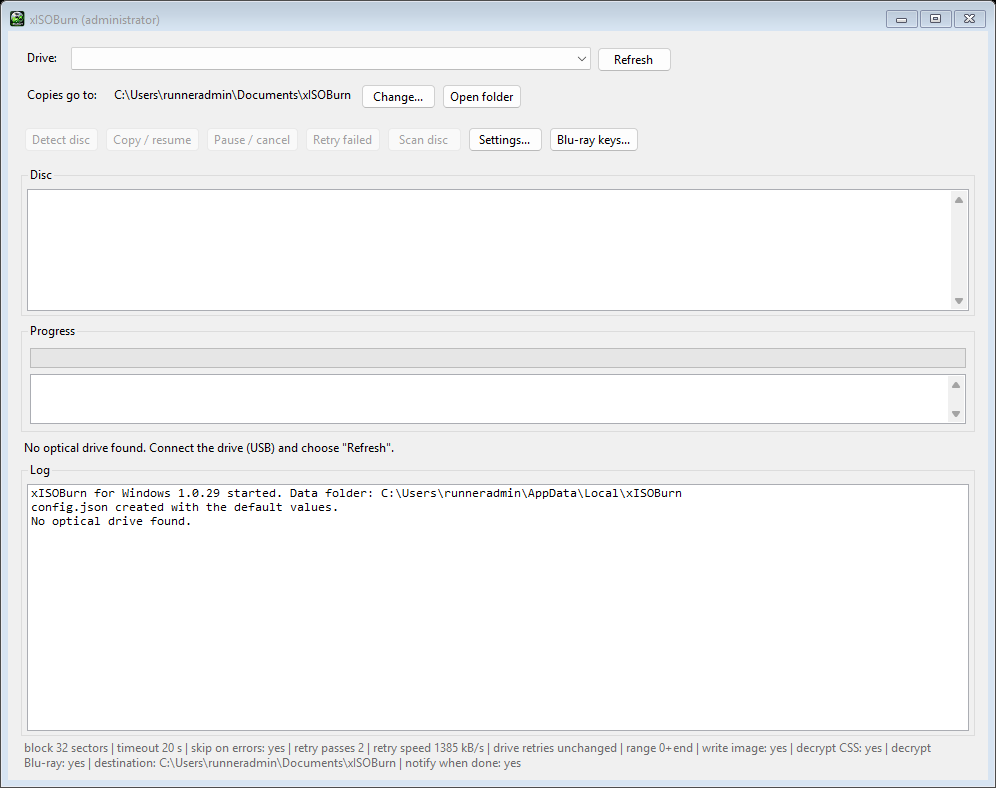
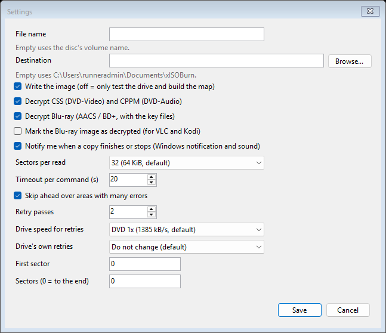
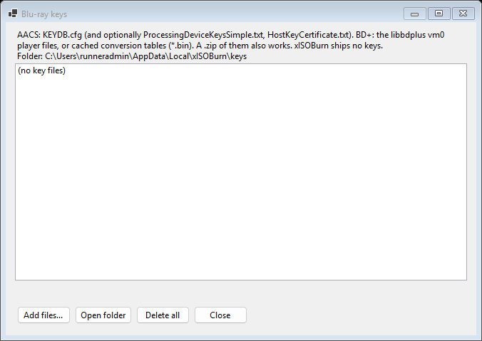

<p align="center">
  
</p>

# xISOBurn for Windows

The Windows version of [xISOBurn](https://github.com/rubinhos/xisoburn). It copies the disc in a PC
optical drive, internal or external (USB), to an ISO image, sector by sector. It uses the same copy
engine as the Xbox app, with a Windows window in place of the console screen and the web page.

- **Damaged discs:** the copy runs in multiple resumable passes, in the style of ddrescue. The
  readable data is copied first, then the damaged areas. A map records every sector, and the
  SHA-256 is computed when nothing is left to read.
- **CSS-protected DVD-Video:** the app authenticates with the drive and decrypts the video while
  copying, so the ISO plays in any player. The disc's region has to match the drive's region
  (unless the drive is region-free: then the keys are recovered from the video). DVD-Audio discs
  (CPPM) are decrypted the same way.
- **AACS / BD+ Blu-ray (experimental):** with the key files you add under **Blu-ray keys**
  (`KEYDB.cfg`, and for BD+ the libbdplus `vm0` player files or cached conversion tables), the app
  decrypts the `.m2ts` streams while copying and applies the BD+ fixups. The app ships no keys.
  **Mark the image as decrypted** (Settings) renames the `AACS` folder in the image, so VLC and Kodi
  open it without asking for keys.
- **External drives:** USB drives are listed together with internal ones and the list refreshes when
  a drive is plugged in. When the USB connection limits how much can be read at once, the app reads
  in smaller blocks by itself. During a copy the app has the drive to itself and the tray is locked.
- **CDs:** data CDs give an ISO; audio and mixed-mode CDs are copied raw to `.bin` + `.cue`.
- **Checksums:** besides the SHA-256, a `.hashes` file with the size, CRC32, MD5 and SHA-1 that
  [redump.org](http://redump.org) lists, to check a copy against its entry.



## Supported discs

| Disc | Image | Tested on the PC |
|------|-------|------------------|
| Data DVD, DVD-Video without protection | `.iso` | Same engine as the Xbox app, tested there |
| CSS-protected DVD-Video | `.iso`, video decrypted | Same engine as the Xbox app, tested there |
| DVD-Audio (CPPM) | `.iso`, audio decrypted | Not yet |
| Blu-ray, AACS 1 / BD+ (experimental) | `.iso`, streams decrypted with your key files | Yes, a Blu-ray in an external USB drive |
| Blu-ray, AACS 2 (UHD) | `.iso`, only with a VUK or unit keys in `KEYDB.cfg` | Not yet |
| Data CD-ROM | `.iso` | Tested on the Xbox ([xisoburn#7](https://github.com/rubinhos/xisoburn/issues/7)) |
| Audio CD, mixed-mode CD | `.bin` + `.cue` | Not yet |

If you try one that says "Not yet", an issue with the log (`%LOCALAPPDATA%\xISOBurn`) is very welcome.

## Download and run

1. Open the repository's **Releases** page. Every build of `master` is published there.
2. Download `xISOBurn-<version>-win-x64.exe` (Intel / AMD PCs) or `-win-arm64.exe` (Windows on ARM).
   `SHA256SUMS.txt` has the checksums of both.
3. Run it. You don't need to install anything: the `.exe` includes .NET.

The executable is not code-signed yet, so Windows may stop it:

- **SmartScreen** ("Windows protected your PC"): choose **More info > Run anyway**.
- **Smart App Control** (Windows 11; "Smart App Control blocked an app that may be unsafe"): it has no
  "run anyway", and unblocking the file in its properties does not help. It only allows signed or
  well-known programs. Until the releases are signed, the only way is to turn it off in **Windows
  Security > App & browser control > Smart App Control settings**. On older Windows 11 builds turning
  it off cannot be undone without reinstalling Windows; recent builds let you turn it on again.

If Windows refuses SCSI commands to the drive for a standard user, the app offers to restart as
administrator.

## How to use

| In the window | What it is |
|---------------|------------|
| **Drive** | The optical drive to use, with its model and bus (USB, SATA...). **Refresh** lists the drives again |
| **Copies go to** | The folder for the `.iso`, `.map`, `.sha256` and `.hashes` files (default `Documents\xISOBurn`). **Change...** picks another folder, **Open folder** shows it in Explorer |
| **Detect disc** | Reads the disc type, size, volume name and protection, and shows them in **Disc** |
| **Copy / resume** | Starts the copy, or continues a paused or unfinished one from where it stopped |
| **Pause / cancel** | Pauses the copy. Nothing is lost: **Copy / resume** continues later, even after the app was closed |
| **Retry failed** | Tries the sectors that could not be read once more. It is only enabled when there are some |
| **Scan disc** | A quick read-only health check that reads about 90 spots across the disc. It writes nothing |
| **Settings...** | The settings below |
| **Blu-ray keys...** | Adds key files (or a `.zip` of them), opens the keys folder, or deletes every key |
| **Progress** | The bar shows how much of the disc is copied. The text shows the current pass, speed and time left |
| Log | Everything the app does, line by line. Select lines and press Ctrl+C to copy them |

Usually you only need **Detect disc** and then **Copy / resume**. While a copy or a scan is running:

- the PC does not go to sleep, and when the copy finishes or stops you get a Windows notification
  and a sound (Settings can turn that off);
- xISOBurn has the drive to itself, so Explorer, AutoPlay or an antivirus can't read the disc at the
  same time and disturb slow retries;
- the tray is locked, so the eject button does nothing. **Pause / cancel** unlocks it.

If Windows refuses the exclusive access or the tray lock, the copy goes on without it and the log
says why.

Blu-ray images are larger than 4 GiB: the destination must be NTFS or exFAT, not FAT32.

## Settings

| Settings | Blu-ray keys |
|----------|--------------|
|  |  |

| Setting | Default | What it does |
|---------|---------|--------------|
| File name | empty | Name of the ISO. Empty uses the disc's volume name |
| Destination | empty | Folder for the copies. Empty uses `Documents\xISOBurn` |
| Write the image | on | Off only tests the drive and builds the map, without saving the ISO |
| Decrypt CSS and CPPM | on | Off copies DVD-Video and DVD-Audio as they are on the disc, still encrypted |
| Decrypt Blu-ray | on | Off copies the Blu-ray streams as they are on the disc, still encrypted |
| Mark the image as decrypted | off | Renames `AACS` in the image so libbluray players open it without keys |
| Notify me when a copy finishes or stops | on | A Windows notification, a sound and a flashing taskbar button. Clicking the notification brings xISOBurn to the front. Pausing it yourself gives no notification |
| Sectors per read | 32 | How much is read at once in the good areas (lowered automatically to what the drive's connection accepts) |
| Timeout per command | 20 s | How long to wait for the drive on each read |
| Skip ahead over areas with many errors | on | Copies the easy parts first and comes back to the damaged ones |
| Retry passes | 2 | Extra passes over the sectors that still fail |
| Drive speed for retries | DVD 1x | Reading slowly often recovers scratched sectors (DVD and BD speeds to choose from) |
| Drive's own retries | do not change | Experimental. Lower values make failing reads give up sooner |
| First sector / Sectors | 0 / 0 | Copies only part of the disc, for tests. 0 sectors means to the end |

The settings, the logs and the Blu-ray keys are stored in `%LOCALAPPDATA%\xISOBurn`
(`config.json`, `xisoburn-*.log`, `keys\`). The copy passes, the `.map` format and the CSS and AACS
details are described in the Xbox repository:
[how-it-works.md](https://github.com/rubinhos/xisoburn/blob/master/docs/how-it-works.md).

## Output

A raw image, 2048 bytes per sector, the same as a plain ISO. On CSS discs the video sectors are
decrypted. Sectors that can't be read stay zeros, and the `.map` file next to the image lists them.

**CDs:** a data CD is copied as an ISO. A CD with audio tracks (music, or mixed mode) is copied raw,
2352 bytes per sector, to `NAME.bin` with a `NAME.cue` cue sheet, so it can be played, mounted or
burned again. Only the first session is copied, and there is no read offset correction, so the
checksums of audio tracks usually differ from redump.org.

The `.sha256` file holds the hash of the finished image, and the `.hashes` file its size, CRC32,
MD5, SHA-1 and SHA-256: the checksums [redump.org](http://redump.org) lists, so the copy can be
checked against its entry. On CSS discs the image is decrypted, so it only matches a Redump entry made
from decrypted data; turn off **Decrypt CSS** to keep the sectors as on the disc.

## Building

Everything builds on GitHub Actions ([.github/workflows/build.yml](.github/workflows/build.yml)):
`dotnet publish` makes a single self-contained `.exe` for `win-x64` and `win-arm64`. Pull requests
are built too, and every push to `master` creates a release. To build on your own PC you need the
.NET 10 SDK and the submodule:

```
git clone --recurse-submodules https://github.com/rubinhos/xisoburn-pc.git
dotnet publish src/xISOBurn/xISOBurn.csproj -c Release -r win-x64 --self-contained -p:PublishSingleFile=true
```

The screenshots in `docs/images/` come from the **screenshots** workflow (Actions tab → Run workflow):
it runs the app with `--screenshots <folder>`, which saves the real windows as PNG files and exits.

## Repository layout

| Folder | Contents |
|--------|----------|
| `xisoburn/` | Git submodule: the [xisoburn](https://github.com/rubinhos/xisoburn) repository. The app compiles its `engine/` folder (disc detection, multi-pass copy, sector map, disc scan, CSS, AACS and BD+) |
| `src/xISOBurn/Scsi/` | Drive access: `CreateFile` + `IOCTL_SCSI_PASS_THROUGH`, drive list |
| `src/xISOBurn/Core/` | Settings and copy folder |
| `src/xISOBurn/*.cs` | The Windows window, the settings and the Blu-ray keys dialogs, `Platform.cs` |

The Xbox app and this one compile the same engine, so a fix there reaches both. To take a new engine
version: `git submodule update --remote xisoburn`, then commit the new pointer.

## License

GPL-2.0-or-later, like xISOBurn and the libraries it ports (libdvdcss, libaacs, libbdplus). See
[LICENSE](LICENSE).
